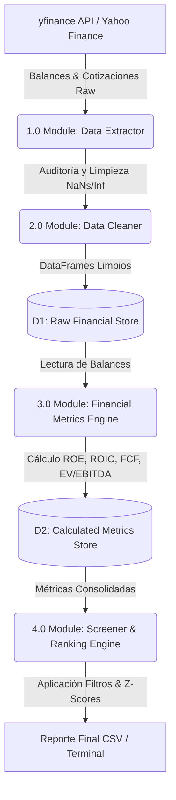
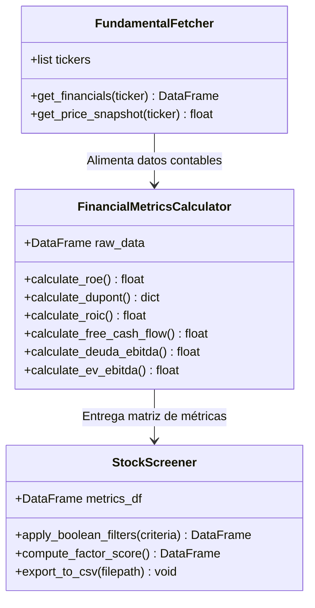

# Especificación de Alcance y Arquitectura (v1.0)
## Screener & Modelo de Análisis Fundamental Cuantitativo

### Control de Versiones
* **Proyecto:** Screener Fundamental Cuantitativo
* **Versión:** 1.0.0
* **Estado:** Aprobado para Desarrollo
* **Autor:** Equipo de Desarrollo Cuantitativo

---

## 1. Propósito y Objetivos del Proyecto

El objetivo principal de este proyecto es desarrollar un motor cuantitativo en Python para la ingesta, limpieza, procesamiento y clasificación de empresas públicas (Acciones / CEDEARs). 

A diferencia de una operativa algorítmica impulsada únicamente por precios y volatilidad, este sistema evalúa la salud contable, la eficiencia operativa y la valuación relativa de las compañías a través de los **4 Pilares del Análisis Fundamental**:
1. **Rentabilidad y Eficiencia Operativa** ($\text{ROE}$, $\text{ROIC}$, Márgenes).
2. **Salud Financiera y Apalancamiento** ($\text{Deuda Neta / EBITDA}$, $\text{Current Ratio}$).
3. **Generación Real de Efectivo** ($\text{Free Cash Flow - FCF}$).
4. **Valuación Relativa** ($\text{P/E}$, $\text{EV/EBITDA}$).

---

## 2. Definición del Alcance (Scope Boundaries)

Para garantizar la finalización del proyecto y evitar el sesgo de complejidad (*scope creep*), se establecen fronteras estrictas de desarrollo:

### 2.1 Dentro del Alcance (In-Scope - v1.0)

* **Universo de Activos (10 Tickers Iniciales):**
  * *CEDEARs Defensivos:* Coca-Cola (`KO`), PepsiCo (`PEP`), Procter & Gamble (`PG`), Johnson & Johnson (`JNJ`), Walmart (`WMT`).
  * *CEDEARs de Crecimiento / Locales:* YPF (`YPF`), Mercado Libre (`MELI`), Apple (`AAPL`), Microsoft (`MSFT`), SPDR S&P 500 (`SPY`).
* **Ingesta de Datos Contables:**
  * Descarga automatizada de Estados de Resultados, Balances Generales y Flujos de Caja mediante la librería `yfinance`.
* **Cálculo de Indicadores Cuantitativos:**
  * *Rentabilidad:* $\text{ROE}$, $\text{ROIC}$, $\text{Margen Bruto}$, $\text{Margen Operativo (EBIT)}$, $\text{Margen Neto}$, y Descomposición de DuPont.
  * *Salud Financiera:* $\text{Deuda Neta / EBITDA}$, $\text{Current Ratio}$.
  * *Flujo de Caja:* $\text{Free Cash Flow (FCF)} = \text{Operating Cash Flow} - \text{CAPEX}$.
  * *Valuación:* Ratio $\text{P/E}$ (Precio a Ganancias) y ratio $\text{EV/EBITDA}$.
* **Motor de Filtrado y Ranking (*Factor Scoring*):**
  * Aplicación de filtros booleanos configurables (ej. $\text{ROE} > 0.15 \land \text{Deuda/EBITDA} < 2.5$).
  * Cálculo de un puntaje compuesto por activo (*Z-Score* estandarizado).
* **Exportación de Resultados:**
  * Generación de reportes tabulares estructurados en consolas de comandos y persistencia en archivos `.csv`.
* **Automatización y Entorno:**
  * Automatización del entorno mediante `Makefile` y batería de pruebas con `pytest`.

### 2.2 Fuera del Alcance (Out-of-Scope - Prohibido en v1.0)

* **Modelos de Aprendizaje Automático (Machine Learning / IA):** Sin redes neuronales, bosques aleatorios o predicción de precios por regresiones no lineales.
* **Ejecución Automática de Órdenes:** No se conectará con APIs de brokers (como IOL o Interactive Brokers) para transaccionar capital real.
* **Procesamiento de Lenguaje Natural (NLP):** No se procesarán transcripciones de conferencias de ganancias (*earnings calls*), noticias ni redes sociales.
* **Datos Intradiarios / Ticks:** La ingesta contable se basa exclusivamente en balances trimestrales y precios de cierre diarios.
* **Valuación por Flujo de Fondos Descontados (DCF) Complejo:** No se construirán proyecciones macroeconómicas a 5 años; las métricas serán de valuación relativa presente.

---

## 3. Diagramas de Flujo y Arquitectura

### 3.1 Diagrama de Flujo de Datos (DFD - Nivel 1)

El siguiente diagrama detalla la transformación del dato contable crudo hasta la generación del ranking final:

### 3.2 Diagrama de Clases (UML Modular)

*(Nota: Los diagramas Mermaid integrados en este Markdown se pueden renderizar o exportar directamente a archivos `.png` mediante la extensión 'Markdown Preview Mermaid Support' en VS Code o herramientas como `mermaid-cli`).*

---

## 4. Requisitos No Funcionales (RNF)

* **RNF-01 (Parsimonia):** El código debe ser completamente modular, separando la extracción de datos de la lógica matemática de cálculo.
* **RNF-02 (Desempeño):** La ingesta y cálculo de los 10 activos del universo debe ejecutarse en menos de 10 segundos.
* **RNF-03 (Tolerancia a Fallos - Fail-Safe):** Si un ticker no presenta un dato contable en `yfinance`, el sistema asignará `NaN` con una advertencia en el log, permitiendo que el resto del universo continúe procesándose.
* **RNF-04 (Cobertura de Pruebas):** El módulo de cálculo matemático (`FinancialMetricsCalculator`) debe alcanzar el $100\%$ de cobertura de pruebas unitarias.

---

## 5. Criterios de Aceptación (Definition of Done)

El proyecto v1.0 se dará por concluido únicamente cuando:
1. Las métricas calculadas para Coca-Cola (`KO`) e YPF (`YPF`) mediante el script coincidan con una margen de error $< 0.5\%$ respecto a sus reportes trimestrales oficiales (Formulario 10-Q / 20-F ante la SEC).
2. La suite de pruebas `pytest` se ejecute con 0 fallos.
3. El archivo de salida `screener_result.csv` muestre el ranking ordenado correctamente por el *Factor Score*.